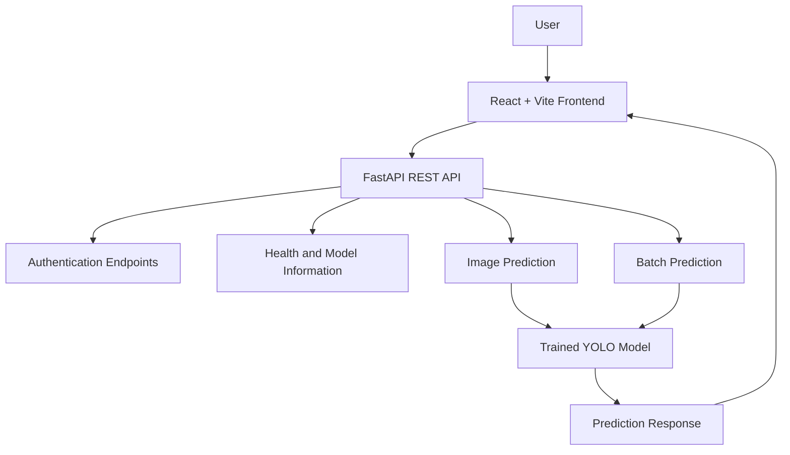

# DEFECTVISION.AI
### AI-Powered Steel Surface Defect Detection Platform

<p align="center">
  <strong>Detect Defects. Improve Quality. Build Smarter.</strong>
</p>

<p align="center">
  An AI-powered computer vision platform for detecting and classifying steel surface defects using a trained YOLO model.
</p>

<p align="center">
  <a href="https://defectvision-lovat.vercel.app/"><strong>🚀 Live Application</strong></a>
  &nbsp; • &nbsp;
  <a href="https://defectvision-x99c.onrender.com/docs"><strong>📚 API Documentation</strong></a>
  &nbsp; • &nbsp;
  <a href="https://defectvision-x99c.onrender.com/health"><strong>💚 API Health</strong></a>
</p>

<p align="center">
  
  
  
  
  
</p>

<p align="center">
  
  
  
</p>

---

## 📌 Table of Contents

- [Overview](#-overview)
- [Problem Statement](#-problem-statement)
- [Key Features](#-key-features)
- [Defect Categories](#-defect-categories)
- [Technology Stack](#-technology-stack)
- [System Architecture](#-system-architecture)
- [Live Deployment](#-live-deployment)
- [Installation and Setup](#-installation-and-setup)
- [Environment Variables](#-environment-variables)
- [API Reference](#-api-reference)
- [Model Configuration](#-model-configuration)
- [Project Structure](#-project-structure)
- [Troubleshooting](#-troubleshooting)
- [Future Scope](#-future-scope)
- [Contributing](#-contributing)
- [License](#-license)

---

## 🎯 Overview

**DEFECTVISION.AI** is an AI-powered steel surface inspection platform that uses computer vision to classify surface defects from images.

Traditional visual inspection can require considerable time and attention. This project explores how a trained deep-learning model can assist the inspection process by identifying defect categories through an API-driven web application.

The platform combines a React-based frontend, a FastAPI backend, and trained YOLO model weights to provide a foundation for AI-assisted industrial quality inspection.

### What makes this project interesting?

- Combines frontend development with computer vision and deep learning.
- Integrates a trained model into a deployed web application.
- Exposes model functionality through REST API endpoints.
- Includes user registration and authentication endpoints.
- Uses separate frontend and backend deployments.

## 🚧 Problem Statement

Steel manufacturing and processing require reliable surface quality inspection. Defects such as scratches, cracks, inclusions, and pits can affect product quality and require careful identification.

Manual inspection can be time-consuming and may vary between inspectors. DEFECTVISION.AI explores an AI-assisted approach that classifies visible surface defects using a trained model.

**Project objective:** Build a web-based system that connects a computer vision model with an accessible interface and backend API for steel surface defect inspection.

## ✨ Key Features

| Feature | Description |
|---|---|
| 🧠 AI-based classification | Uses trained YOLO model weights for image inference |
| 🔎 Six defect categories | Supports six configured steel surface defect classes |
| 🌐 Web interface | Provides a browser-based frontend |
| ⚡ REST API | Connects the frontend with the Python backend |
| 📦 Batch prediction | Includes an endpoint for batch image processing |
| 🔐 Authentication | Includes registration, login, and current-user endpoints |
| 🩺 Health monitoring | Provides a backend health-check endpoint |
| ☁️ Cloud deployment | Frontend deployed on Vercel and backend on Render |

## 🔬 Defect Categories

The trained model is configured for the following six classes:

| # | Class | Description |
|---:|---|---|
| 1 | `crazing` | Fine crack-like patterns on the surface |
| 2 | `inclusion` | Foreign material or inclusions |
| 3 | `patches` | Patch-like surface irregularities |
| 4 | `pitted_surface` | Small pits or cavities |
| 5 | `rolled-in_scale` | Scale pressed into the surface during rolling |
| 6 | `scratches` | Linear surface marks or scratches |

*The descriptions are general interpretations of the class names. Actual prediction quality depends on the model, dataset, and evaluation results.*

## 🛠️ Technology Stack

### Frontend
- **React** — component-based user interface
- **Vite** — development server and build tooling
- **JavaScript** — application logic
- **Tailwind CSS** — utility-first styling, where configured

### Backend and AI
- **Python** — backend and inference environment
- **FastAPI** — REST API framework
- **Uvicorn** — ASGI server
- **Ultralytics YOLO** — model inference
- **OpenCV** — image-processing support
- **NumPy** — numerical operations
- **Pillow** — image handling
- **SQLite** — authentication data storage

### Deployment
- **Vercel** — frontend hosting
- **Render** — backend hosting
- **Git and GitHub** — source control and collaboration

## 🏗️ System Architecture



### Request Workflow

1. The user interacts with the web application.
2. The frontend sends HTTP requests to the FastAPI backend.
3. The backend validates the request and processes the relevant operation.
4. For image inference, the backend loads and uses the trained YOLO weights.
5. The API returns the response to the frontend.

## 🌍 Live Deployment

| Service | URL |
|---|---|
| **Frontend Application** | [defectvision-lovat.vercel.app](https://defectvision-lovat.vercel.app/) |
| **Backend Service** | [defectvision-x99c.onrender.com](https://defectvision-x99c.onrender.com) |
| **Health Endpoint** | [Check API Health](https://defectvision-x99c.onrender.com/health) |
| **Swagger UI** | [Explore API Endpoints](https://defectvision-x99c.onrender.com/docs) |

> **Deployment note:** A hosted backend may take longer to respond after being idle. Availability can also depend on the hosting service and its configuration.

## 💻 Installation and Setup

Follow these steps to run the project locally.

### Prerequisites

Install the following:

- Git
- Node.js and npm
- Python version supported by the project's ML dependencies

### 1. Clone the Repository

```bash
git clone https://github.com/yashbsl/DEFECTVISION.git
cd DEFECTVISION
```

### 2. Configure the Backend

```bash
cd backend
python -m venv .venv
```

Activate the virtual environment.

**Windows PowerShell**

```powershell
.venv\Scripts\Activate.ps1
```

**Windows Command Prompt**

```bat
.venv\Scripts\activate.bat
```

**macOS / Linux**

```bash
source .venv/bin/activate
```

Install the backend requirements:

```bash
pip install -r requirements.txt
```

Start the API server:

```bash
uvicorn main:app --reload
```

The backend should be available at:

- API: `http://127.0.0.1:8000`
- Health check: `http://127.0.0.1:8000/health`
- Interactive documentation: `http://127.0.0.1:8000/docs`

### 3. Configure the Frontend

Open a second terminal from the repository root:

```bash
cd frontend
npm install
```

Create a `.env` file inside the `frontend` directory:

```env
VITE_API_URL=http://127.0.0.1:8000
```

Start the frontend:

```bash
npm run dev
```

Open the local development URL shown in the terminal.

**Important:** Start the backend and frontend in separate terminals. Restart the Vite server after changing local environment variables.

## ⚙️ Environment Variables

### Frontend

| Variable | Purpose | Example |
|---|---|---|
| `VITE_API_URL` | Base URL of the backend API | `https://defectvision-x99c.onrender.com` |

For local development:

```env
VITE_API_URL=http://127.0.0.1:8000
```

### Backend

Configure the CORS environment variable in Render if the backend is set up to read it:

```env
CORS_ORIGINS=https://defectvision-lovat.vercel.app
```

For local development, the backend may also need to allow:

```text
http://localhost:5173
```

Vite variables are included during the frontend build, so changes to `VITE_API_URL` require a new frontend deployment.

**Security:** Never commit passwords, private keys, signing secrets, access tokens, or credentials to GitHub.

## 📡 API Reference

The backend provides these endpoint groups:

| Method | Endpoint | Purpose |
|---|---|---|
| `GET` | `/` | API status or welcome information |
| `GET` | `/health` | Backend and model health |
| `GET` | `/model-info` | Model information |
| `POST` | `/predict` | Image prediction |
| `POST` | `/predict-batch` | Batch image prediction |
| `POST` | `/auth/register` | User registration |
| `POST` | `/auth/login` | User login |
| `GET` | `/auth/me` | Current authenticated user |

For request schemas, required fields, response formats, and interactive endpoint testing, visit the [Swagger API Documentation](https://defectvision-x99c.onrender.com/docs).

## 🧠 Model Configuration

The backend expects the trained model weights at:

```text
backend/models/best.pt
```

The model file must be available in the runtime environment for inference to work.

Installing the backend dependencies does not generate the trained weights. If the file is excluded from Git, make sure the deployment process supplies it at the expected path.

Model predictions should be evaluated against appropriate test data before the system is used in a production inspection environment.

## 📁 Project Structure

```text
DEFECTVISION/
│
├── backend/
│   ├── main.py
│   ├── requirements.txt
│   └── models/
│       └── best.pt
│
├── frontend/
│   ├── package.json
│   └── src/
│
└── README.md
```

*This is a representative structure; the actual repository may contain additional files and folders.*

## 🧰 Troubleshooting

### `Failed to fetch` on Login or Signup

- Verify that the backend health endpoint is responding.
- Check the `VITE_API_URL` value configured in Vercel.
- Confirm the backend CORS settings allow the exact frontend origin.
- Redeploy the frontend after changing Vite environment variables.
- Inspect the browser's Developer Tools under **Network** and **Console**.

### Model Loading Failure

- Confirm that `backend/models/best.pt` exists.
- Review the backend logs for model-loading errors.
- Ensure the model weights are available in the deployed environment.

### Frontend Cannot Reach the Local API

- Make sure the backend server is running.
- Confirm that the frontend API URL is correct.
- Restart Vite after modifying `.env`.
- Check the browser console for network or CORS errors.

## 🚀 Future Scope

Potential areas for further development include:

- Inspection history and prediction tracking
- Visual overlays for detected defects
- Downloadable inspection reports
- Confidence-based filtering and reporting
- Expanded datasets and model evaluation
- Improved monitoring and production deployment

*These are potential enhancements, not claims that the features are already implemented.*

## 🤝 Contributing

Contributions and suggestions are welcome.

1. Create a feature branch.
2. Implement a focused change.
3. Test the affected functionality.
4. Submit a pull request describing the change.

## 📄 License

A license has not yet been specified. Add a `LICENSE` file to clearly define how the project may be used, modified, and distributed.

---

<p align="center">
  <strong>DEFECTVISION.AI</strong><br/>
  AI-assisted steel surface inspection
</p>
